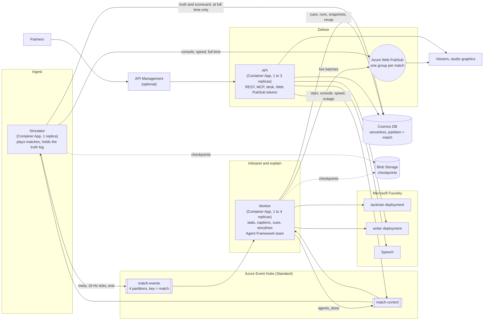

# Architecture

GroundTruth is three roles over three managed services. The same code runs as one process on
a laptop (everything in memory) and as separate Container Apps on Azure.

## Why each piece is there

| Choice | Reason |
| --- | --- |
| Event Hubs between the simulator and the workers | The feed is source-agnostic: the simulator, a vision service or a real data provider publish the same messages. Partitioning by match keeps each match in order and on one worker. |
| Messages packed into envelopes | A throughput unit counts events. One event carries many 0.1 s ticks, so a match at 40x uses a handful of events a second. A throttled send backs off and retries. |
| Checkpoints only between matches | A worker that dies mid-match leaves the partition un-checkpointed. The next owner (within about 20 seconds) replays the match from kick-off; the stats rebuild exactly because they are deterministic, documents are rewritten under the same ids, and moments that already have an agent run are not explained twice. |
| The truth log stays in the simulator | Nothing downstream can see a hidden change until full time, by construction: the truth never travels on the bus. The simulator grades the match from the store at full time, and again if a replaying worker reports late. |
| Cosmos DB, one container partitioned by match | Every read the app makes stays in one partition; serverless costs nothing between matches; documents expire after 30 days. |
| Web PubSub, one group per match | Viewers connect to the service, not to our servers. A message is sent once per match and reaches every viewer; personalisation happens in the browser from the shared stream, so it costs nothing per viewer. |
| A stateless API | Any replica can serve any request: reads come from Cosmos DB, the desk and the MCP tools read a store-backed view of the match as of a viewer's minute. |
| Three identities, least privilege | The simulator may only send match events and read control; the workers may read events, send agents_done and call the models; the API may only send control commands, call the models and use Speech. Every service has local authentication turned off: no keys anywhere. |
| Foundry guardrails | The default harm filters and prompt shields run on every model call, including questions typed into the Ask box. |

## Proved in CI without Azure

The `distributed` job starts the Event Hubs, Cosmos DB and Storage emulators, runs the three roles
as separate processes over the real Azure SDKs, plays a match end to end, then kills the worker
mid-match and checks that a new one takes the match over and it still reaches a graded full time
(`scripts/distributed_check.py`).
